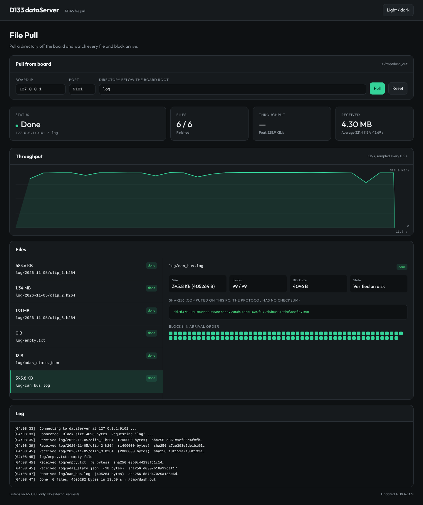

# D133 dataServer dashboard

Web dashboard for pulling ADAS files off the D133 board over the dataServer
protocol (NikosMav/System-Programming-3 wire format, see `../rtthread/dataserver.c`).

The Flask backend (polled at `/api/status`) comes from
[MusadiqPasha/file_transfer](https://github.com/MusadiqPasha/file_transfer); the transfer
underneath is replaced by `rtthread/remote_client.py`. The page is skinned with the design
tokens, Outfit font and card/list/panel components of
[Niko1221/Strata](https://github.com/Niko1221/Strata) (MIT, `web/LICENSE-Strata.txt`;
font: SIL OFL, `web/fonts/OFL.txt`). Light and dark themes.

## Run (on the PC joined to the board's WiFi AP or plugged into its Ethernet)

    pip install flask
    python client_web.py                 # http://localhost:5002

Environment overrides: `DATASERVER_HOST` (default 192.168.169.1),
`DATASERVER_PORT` (9000), `DATASERVER_STAT_PORT` (9001), `DASHBOARD_PORT` (5002), `DASHBOARD_OUT` (./received).

Enter the board IP, port and a directory below the board's `DATASERVER_ROOT`
(default `/data/adas`), then press **Pull**. Files land in `received/<dir>/...`.

## What it shows

| Panel | Source |
|---|---|
| Status, files, throughput, received cards | live from `/api/status` |
| Throughput curve (now / peak) | 0.5 s samples of received bytes |
| Files list + detail | one row per file announced by the board; size, blocks, state |
| Blocks of the selected file | one box per received block |
| SHA-256 of each file | computed on the PC after the file is written |
| Log | connect, block size, per-file result, errors |
| Board network: per-interface cards and rx/tx curves | board port 9001 (`rtthread/dsstat.c`), 1 s samples |
| Board network: forwarded packets, board-side files and bytes | same JSON line |

The protocol itself has no checksum. The SHA-256 is for comparing against
`sha256sum` on the source; it does not prove the board sent the right bytes.

## API

| Route | Method | Purpose |
|---|---|---|
| `/` | GET | the page |
| `/api/config` | GET | default board, port, output dir |
| `/api/pull` | POST `{board, port, directory}` | start a pull (409 if one is running) |
| `/api/status` | GET | full transfer state |
| `/api/reset` | POST | clear state |
| `/api/board?board=IP&port=9001` | GET | board network stats; starts a 1 s poller that stops 10 s after the page stops asking |

## Notes

- Listens on `127.0.0.1` only; no web fonts or CDN, works with no internet.
- File names from the board are rendered as text, never as HTML.
- Page files: `client_ui.html` and `web/` (`strata-components.css`, `tokens.css`,
  `dashboard.css`, `dashboard.js`, fonts). Only `web/` is served.
- `server.py`, `server_ui.html`, `client.png`, `server.png` and `utils.py` are
  the unmodified upstream TCP-upload demo. The D133 dashboard does not use
  them; they are kept for reference and can be deleted.
- `d133_dashboard.png` was taken with headless Chromium against the host build of the
  C server (`make -C ../rtthread/host`) behind a ~330 KB/s throttle, not against the board.
- Tests: `python3 -m unittest discover -s ../rtthread/tests -v`
