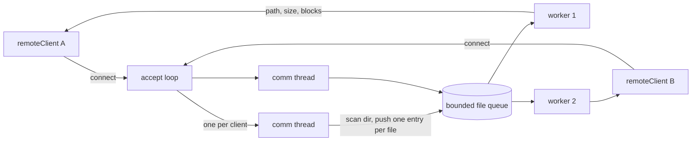
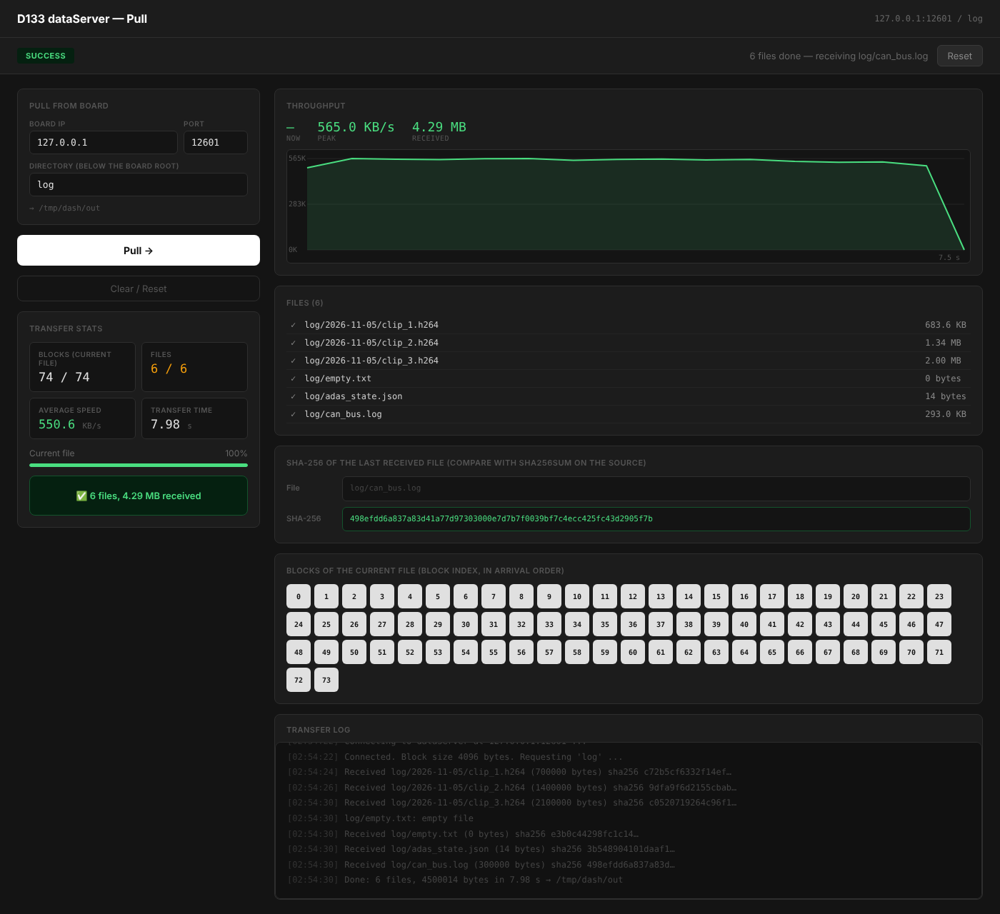

# dataServer on D133 (RT-Thread port)

A port of [NikosMav/System-Programming-3](https://github.com/NikosMav/System-Programming-3)
(multi-threaded data server + remote client) to the D133 board, used to pull
ADAS data (logs, event clips, calibration) from the board over its WiFi AP or
Ethernet port.

The upstream repository is imported with `git subtree` (full history kept) in
the parent directory. `Project2/` is the upstream C++ code with bug fixes; this
`rtthread/` directory is the C port that runs on the board. The wire protocol
is unchanged, so the upstream `remoteClient` works against the board.

> Upstream license: the repository has no license file and states it is for
> educational use. This port is for evaluation only; do not ship it in a
> product without the author's permission.

## Architecture (same as upstream)



* The comm thread sends `block_size`, reads the requested directory, scans it
  into an `fpath` tree and pushes one queue entry per file (blocking while the
  queue is full).
* Workers take the first entry whose socket no other worker is serving
  (`busy[]`), so the files of one client are never interleaved on its socket.
* The socket is closed after the last file of the request.

## Wire protocol

| Direction | Bytes | Content | Reply |
|---|---|---|---|
| S→C | 4 | `int block_size` (little-endian) | ack |
| C→S | 512 | requested directory, NUL padded, relative to the server root | ack |
| S→C | 512 | file path relative to the root, NUL padded | ack |
| S→C | 4 | `int file_size` | ack |
| S→C | `block_size` × ⌈size/block⌉ | file data, last block zero padded | ack after each block |

`ack` is the 4 bytes `}#%\0`, sent by the receiver after every complete chunk.
The last three rows repeat for every file; the server then closes the socket.

## Upstream bugs fixed (reproduced first, protocol unchanged)

| Problem in upstream | Effect seen with block 512 |
|---|---|
| `block%size` instead of `size%block` (server and client) | 1024-byte file received as 1536 bytes; 256-byte file received empty |
| empty or missing directory never closed the socket | client hangs forever |
| client path used as a server path | `-d /etc/ssl/certs` downloaded system files |
| ack awaited after every partial `send()` | possible deadlock on slow links |
| `wait_respond` used `&&` and short reads | stream desync, busy loop on a dead peer |
| 512-byte path sent from a smaller stack buffer | stack over-read |
| `new[]`/`free()` mismatch, entries and trees leaked | heap corruption risk, memory growth |
| comm threads never joined, SIGPIPE not ignored | thread leak; a client disconnect killed the server |
| worker spins holding the queue lock when every queued socket is busy | 100 % CPU on the MCU (C port waits on a condition instead) |

## Board build (Luban-Lite)

Append to `target/configs/d13x_demo88-nor_rt-thread_helloworld_defconfig`
(requires the POSIX socket options used by the WiFi AP setup):

```
CONFIG_LPKG_USING_DATASERVER=y
```

Kconfig options (`me` → Third-party packages → dataServer): port (9000),
workers (2), queue size (16), block size (4096), root (`/data/adas`), thread
stack (8192), autostart (y).

On the board console:

```
aic /> dataserver
dataserver: running, port 9000, root /data/adas, 2 workers, block 4096
  connections 3, directories sent 3, files sent 41, rejected 0
  queued files 0, 812 KB sent
```

Resource notes: 1 accept thread + `POOL_SIZE` workers + one short-lived comm
thread per connected client, all pthreads (`PTHREAD_NUM_MAX` defaults to 8).
Each socket and each open file uses a DFS descriptor (`DFS_FD_MAX` = 16).

## PC side

Windows / Linux, no compiler needed:

```
python remote_client.py -i 192.168.169.1 -p 9000 -d log          # over WiFi
python remote_client.py -i 192.168.1.1   -p 9000 -d calib -o D:\pull
```

Linux / WSL, upstream client:

```
make -C ../Project2 client
../Project2/remoteClient -i 192.168.169.1 -p 9000 -d log
```

Files land in `results/<dir>/...` (or `-o`).

## Live dashboard (PC)

`../dashboard/` is [MusadiqPasha/file_transfer](https://github.com/MusadiqPasha/file_transfer)
(imported with `git subtree`, history kept) adapted to this protocol: the
browser asks the board for a directory and shows, while it arrives, the live
throughput curve, the file list, the blocks of the current file, the SHA-256
of every received file and the transfer log. It runs offline.

```
pip install -r ../dashboard/requirements.txt
python ../dashboard/client_web.py          # then open http://localhost:5002
```

Environment variables: `DATASERVER_HOST` (default 192.168.169.1),
`DATASERVER_PORT` (9000), `DASHBOARD_OUT` (download directory),
`DASHBOARD_PORT` (5002). The upstream `server.py` / `server_ui.html` are kept
but not used. Upstream has no license file either: evaluation use only.



The protocol does not announce how many files a request contains, so the
"Files" counter grows as files arrive.

## Tests

The board C code is also built for the host and tested against both clients:

```
make -C rtthread/host                 # dataserver_c + upstream remoteClient
python3 -m unittest discover -s rtthread/tests -v
make -C rtthread/host asan            # then rerun the tests
make -C rtthread/host tsan
```

`test_dashboard.py` also drives the dashboard backend (needs Flask).

Covered: block-size edge cases (0, 1, B-1, B, B+1, B/2, 2B, 7B+3, 250 kB),
nested directories, upstream C++ client and Python client, empty/missing
directories, path traversal, 6 parallel clients through a 3-entry queue,
client disconnect mid-transfer, bad ack, 30 sequential requests.
